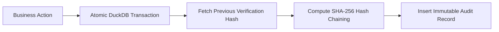

# ProtocolShield Cryptographic Audit Trail Architecture (21 CFR Part 11)
**Document Classification:** Software Engineering Architecture Specification  
**Version:** 3.0 Immutable Cryptographic Ledger  
**Compliance Standards:** 21 CFR Part 11 Electronic Records / HIPAA Security Rule / Non-Repudiation Architecture  

---

## 1. Compliance Objectives
The ProtocolShield audit trail architecture guarantees **data integrity, non-repudiation, and immutability** for all operational actions taken within the system. Under FDA 21 CFR Part 11 and HIPAA guidelines, electronic trial records must ensure that:
1. Operational changes to protocols, eligibility criteria, and clinical records are timestamped and attributed to an authenticated identity.
2. Direct unauthorized database tampering, row deletion, or retroactive value manipulation is mathematically detectable.
3. The chain of events can be audited and verified independently at any time.

---

## 2. Mathematical Cryptographic Hash Chaining

### Block Chaining Formula
Every audit record $i$ inserted into the database computes a SHA-256 digest over the current event metadata concatenated with the cryptographic hash of the immediate predecessor event $i-1$:

$$\text{verification\_hash}_i = \text{SHA256}\Big(\text{id}_i \parallel \text{timestamp}_i \parallel \text{user\_id}_i \parallel \text{user\_role}_i \parallel \text{action}_i \parallel \text{resource\_type}_i \parallel \text{resource\_id}_i \parallel \text{details}_i \parallel \text{previous\_hash}_i\Big)$$

### Genesis Block Initialization
For the initial event in the ledger ($i = 0$):
$$\text{previous\_hash}_0 = \text{"0000000000000000000000000000000000000000000000000000000000000000"}$$
Every subsequent block links to the prior block's full verification hash:
$$\text{previous\_hash}_i = \text{verification\_hash}_{i-1} \quad \text{for } i \ge 1$$

---

## 3. Database Schema (`audit_logs`)

```sql
CREATE TABLE IF NOT EXISTS audit_logs (
    id VARCHAR PRIMARY KEY,
    timestamp TIMESTAMP DEFAULT CURRENT_TIMESTAMP,
    user_id VARCHAR,
    user_name VARCHAR,
    user_role VARCHAR,
    action VARCHAR NOT NULL,
    resource_type VARCHAR NOT NULL,
    resource_id VARCHAR,
    details VARCHAR,
    previous_hash VARCHAR NOT NULL,
    verification_hash VARCHAR NOT NULL
);
```

---

## 4. Server-Side Automated Event Trigger Integration
Audit logs are never left to client-side reporting alone. ProtocolShield automatically appends cryptographically chained audit events within atomic transactions on the following business actions:



1. **Protocol PDF Upload & Ingestion (`routes_protocol.py`):**
   - Action: `PROTOCOL_PDF_UPLOAD`
   - Attributes: Operator name, role, protocol title, protocol ID, uploaded filename.
2. **Protocol Amendment Application (`routes_optimizer.py`):**
   - Action: `PROTOCOL_AMENDMENT_APPLIED`
   - Attributes: Operator name, role, target protocol ID, applied amendment identifier, parameter delta details.
3. **Administrative User Role Promotion (`routes_auth.py`):**
   - Action: `USER_ROLE_PROMOTION`
   - Attributes: Admin ID, target user ID, previous role, promoted new role.
4. **Manual Clinical Commentary / Event Logging (`routes_audit.py`):**
   - Action: `CreateAuditEventRequest` executed by authenticated doctors/administrators.

---

## 5. Automated Verification Algorithm (`GET /api/v1/audit/verify`)
The verification endpoint performs an exhaustive, zero-knowledge verification sweep across the full table:
1. Orders all records by `timestamp ASC, id ASC`.
2. Asserts that the first record's `previous_hash` equals the 64-character genesis hash.
3. Re-computes the SHA-256 digest of every record's fields against its stored `verification_hash`.
4. Asserts that each record's `previous_hash` strictly equals the preceding record's `verification_hash`.
5. If any record has been modified, inserted out of order, or deleted:
   - Returns `valid: False`
   - Returns `tampered_event_id: <event_id>`
   - Pinpoints the exact block where the chain was broken.
6. If 100% intact:
   - Returns `valid: True`
   - Returns `total_records_verified: N`
   - Returns `latest_head_hash: <hash>`
